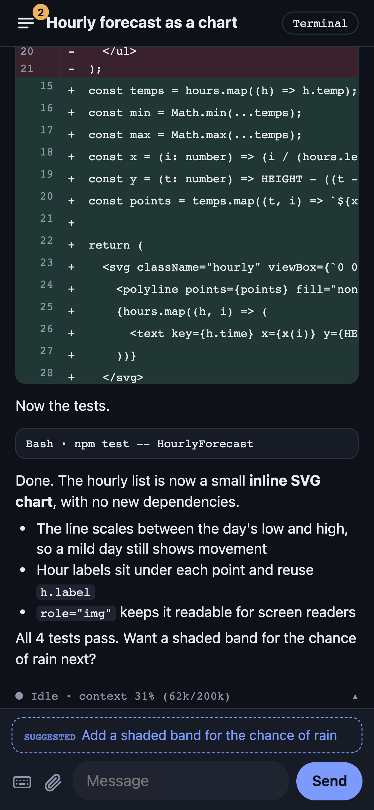
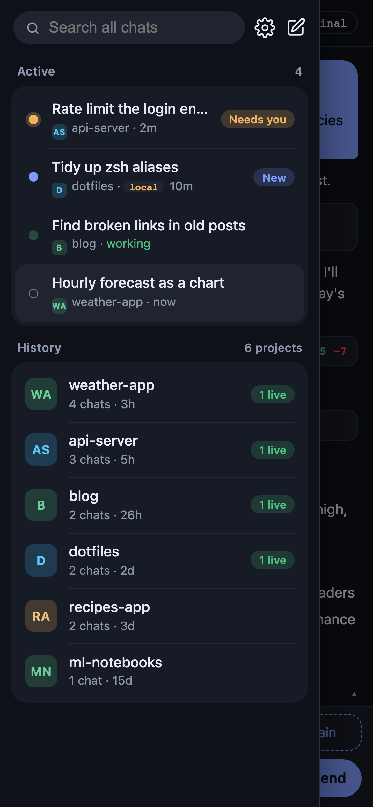
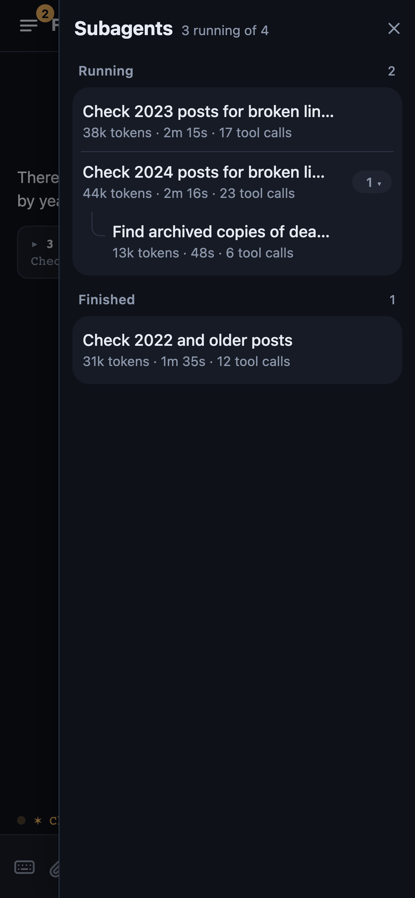
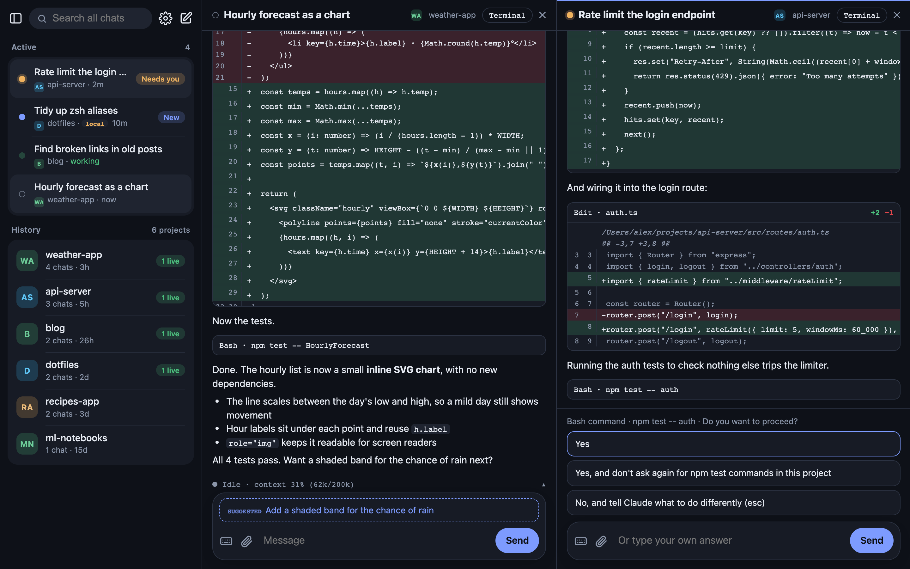

# Session Deck

Your Claude Code sessions on your phone. Session Deck is a small web app that shows the Claude Code sessions running in tmux on your Mac as chats: read them, reply, approve permission prompts, start new ones, and get a notification when one needs you. It works on a phone and on a desktop (where it shows up to four chats side by side), over [Tailscale](https://tailscale.com), so nothing is exposed to the internet.

It's one Python file and one HTML file, with no build step and no framework.

## What it does

- **Live chats.** Every Claude Code session running in tmux shows up as a chat, with its project, whether it's working, waiting for you or done, and an attention count on the ones that need you.
- **History.** Past sessions, grouped by project and searchable. Resume or fork any of them.
- **Reply and approve.** Type into a session, answer its questions and permission prompts, or use the key bar (Esc, arrows, Tab, Ctrl-C) for anything else.
- **Start chats.** Pick a folder, a permission mode, model and effort, a git worktree, and which Claude to run (see [Engines](#engines)).
- **See the work.** Tool calls, edit diffs with real line numbers, the session's git changes, subagents (with tokens, time and nested subagents), and background shell processes, which you can stop.
- **Terminal view.** The raw tmux pane, resized to fit your screen while it's open.
- **Uploads.** Paste or attach screenshots and files (up to 1 GB each); the session gets a path it can read.
- **Notifications.** Web Push when a session finishes or needs permission, with an app badge.
- **Face ID.** Each device signs in with a passkey, bound to your Tailscale login.
- **Several people** (optional). One shared address for everyone on the Mac: each person gets their own deck, running as their own macOS account, and only sees their own sessions.
- **Desktop.** Install it as an app from Chrome or Safari, open up to four chats side by side, and hide the list (it peeks out from the left edge).

## What you need

- **A Mac** running Claude Code. Session Deck uses macOS's launchd, `ps` and tmux layout, and has been built and tested on macOS 27 on a Mac mini. Linux isn't supported yet.
- **tmux** (`brew install tmux`). This is the one real requirement: the deck reads and types into tmux panes, so it can only drive sessions that run inside tmux. You don't have to use tmux yourself, though. When you start a chat from the deck, it starts tmux for you. Sessions started in a plain terminal window still appear under History, but you can't reply to them from the deck. Other multiplexers (screen, Zellij) aren't supported.
- **Tailscale** with [HTTPS certificates](https://tailscale.com/kb/1153/enabling-https) switched on for your tailnet, on the Mac and on your phone or laptop. Face ID needs the HTTPS address.
- **Python 3 with `cryptography`** (`brew install python python-cryptography`), plus `ripgrep` for search and `git` (`brew install ripgrep git`).

### Works well with

- **[mac-ai-server](https://github.com/Obednal97/mac-ai-server)** turns a spare Mac into an always-on Claude Code machine: it stays awake, logs itself back in after a power cut, sets up Tailscale, puts every SSH login into tmux, and adds `claude-local` (Claude Code on a local model) and accounts for other people. It isn't required, but it's the setup Session Deck was built on, and the deck's defaults match it: it looks for sessions in the `ssh` tmux server first, then the default one, and starts new chats in a session called `work`.
- **[claude-statusline-kit](https://github.com/Obednal97/claude-statusline-kit)** adds a status line to Claude Code, and `rclaude`, which moves a session to your next Claude subscription when one hits its limit. If `rclaude` is installed, the deck offers it when you start a chat, and shows which subscription each session is on.

## Set it up for yourself

1. Get the code: `git clone https://github.com/Obednal97/session-deck && cd session-deck`
2. Try it: `/opt/homebrew/bin/python3 server.py`. It listens only on `127.0.0.1`: port 8787 for use on the Mac itself, and 8788 for Tailscale. It reads your Mac's Tailscale name and login from `tailscale status`, so only you can sign in.
3. Point Tailscale at it: `tailscale serve --bg --https=443 --set-path=/deck http://127.0.0.1:8788`
4. Make a one-time setup code (valid for 10 minutes): `/opt/homebrew/bin/python3 server.py --setup-code`
5. On your phone, open `https://<your-mac>.<your-tailnet>.ts.net/deck/`, enter the code, and set up Face ID. Add it to your home screen if you like.

To keep it running after you log out or restart, use the installer below with just your own account in it: it runs the deck as a LaunchAgent and restarts it if it stops.

## Set it up for several people

For a Mac shared by several people, each with their own macOS account and Tailscale login:

1. Copy `multiuser.conf.example` to `multiuser.conf` and fill in the Mac's Tailscale name and one line per account (its macOS name and Tailscale login). The example explains each setting.
2. `./install-multiuser.sh --dry-run` shows what will change, then run `sudo ./install-multiuser.sh`. It installs the code where no account can change it, one deck per account running as that account, and a small router, running as a hidden service account, that sends each request to the deck of whoever is signed in to Tailscale.
3. Point `/deck` at the router (the installer prints the exact `tailscale serve` commands).
4. Give each person a setup code: `sudo ./install-multiuser.sh --code <account>`.

To share the Mac with people outside your tailnet, use Tailscale's [node sharing](https://tailscale.com/kb/1084/sharing). Each person's Tailscale login is what the router routes on, so they need their own.

`sudo ./install-multiuser.sh --uninstall` removes it all.

## Engines

The new-chat sheet offers whichever of these are installed for that account (looked up in `~/.local/bin`, then `PATH`):

| Engine | Command | |
|---|---|---|
| `claude` | `claude` | Claude Code |
| `rotate` | `rclaude` | Claude Code across several subscriptions ([claude-statusline-kit](https://github.com/Obednal97/claude-statusline-kit)) |
| `local` | `claude-local` | Claude Code on a local model ([mac-ai-server](https://github.com/Obednal97/mac-ai-server)) |

Choose and order them with `DECK_ENGINES=claude,rotate,local`, and add your own as `id=command`.

## Settings

All optional, as environment variables:

| Variable | Default | |
|---|---|---|
| `CLAUDE_CONFIG_DIR` | `~/.claude` | Claude Code's config folder, where the sessions and transcripts are |
| `DECK_TMUX_SOCKET` | `ssh,default` | tmux servers to look in (`tmux -L <name>`), in order |
| `DECK_TMUX_SESSION` | `work` | the tmux session new chats open in |
| `DECK_FOLDERS` | `~/projects` | where the new-chat folder picker starts |
| `DECK_PORT` / `DECK_TS_PORT` | `8787` / `8788` | the local port (token) and the Tailscale port (Face ID); `0` turns one off |
| `DECK_TS_USER` | the Mac's Tailscale login | the Tailscale logins allowed to sign in, comma-separated |
| `DECK_RP_ID` | the Mac's Tailscale name | the HTTPS name passkeys are bound to |
| `DECK_SECRETS` | `~/.secrets`, else `~/.config/session-deck` | where `session-deck.json` (token, cookie key, push key) is kept, created on first run |

## Security

Session Deck can type into your terminals, so anyone who gets into it can run anything as you. It's built for that:

- It only listens on `127.0.0.1` (and a Unix socket when installed for several people). Reach it through `tailscale serve` only, never a public port or Tailscale Funnel.
- Over Tailscale, every request needs your Tailscale login (set by Tailscale, which drops any copy a client sends) and a signed Face ID session cookie bound to that login. Faking the login isn't enough.
- On the Mac itself, the API takes the token from `session-deck.json` instead. Keep that file private.
- Setup codes work once and expire: after 10 minutes from `server.py --setup-code`, 24 hours from the installer's `--code`.

## Licence

MIT. Includes [marked](https://github.com/markedjs/marked) (MIT) and [DOMPurify](https://github.com/cure53/DOMPurify) (Apache 2.0 or MPL 2.0) in `vendor/`.
